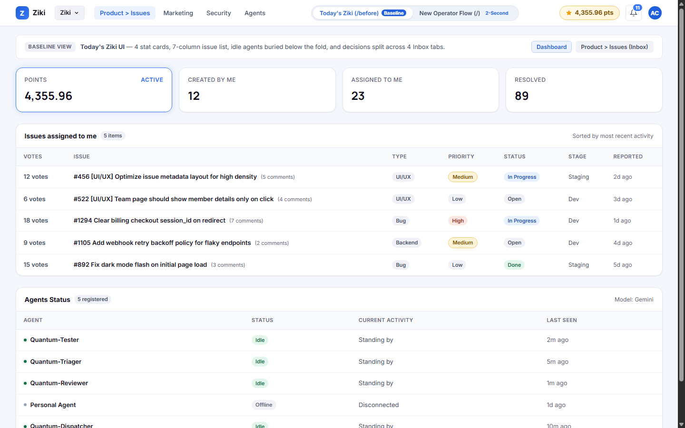
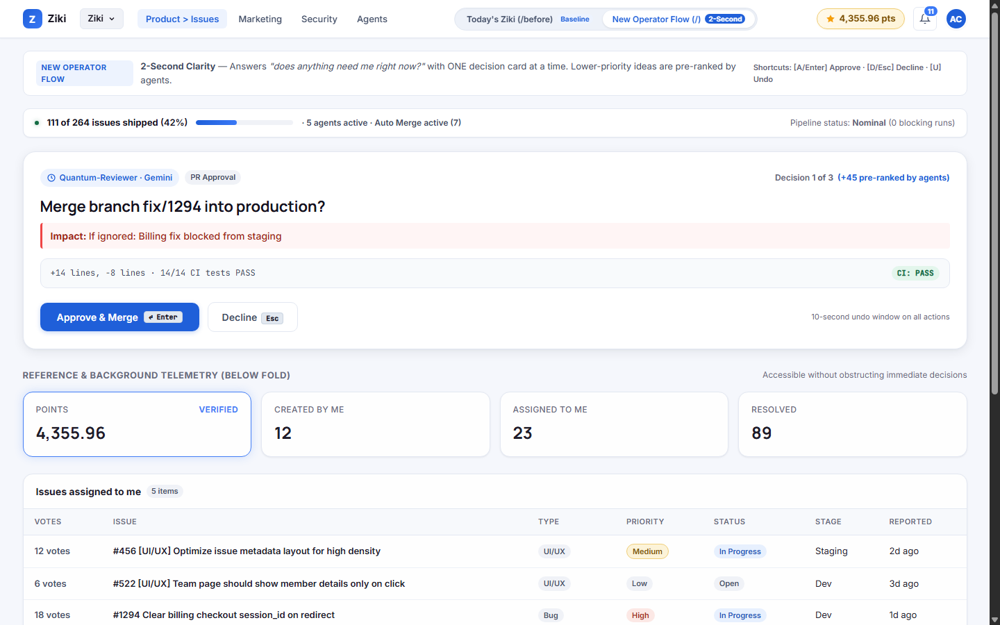
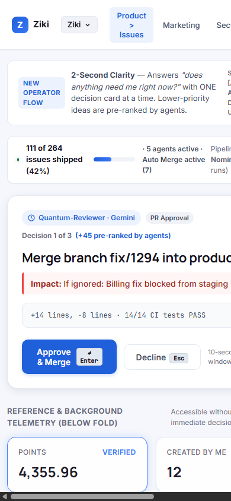

# Ziki: Show Me Only What Needs Me
**Intent Brief — HNG 15 Week 5, Task 1**  
**Author:** Abuchi Collins Nwajagu (`cmvbh8e7h00lumg5p2lrxvw70` / GitHub: [@Collinsthegreat](https://github.com/Collinsthegreat))  
**Lens:** The Operator  
**Live Interactive Canvas:** [https://collinsthegreat.github.io/ziki-cockpit/](https://collinsthegreat.github.io/ziki-cockpit/)  
*(Includes instant `#before` baseline toggle and `#after` operator speed test)*

---

### The Change in One Sentence
> **Ziki’s landing screen should answer *"does anything need me right now?"* in under two seconds, by showing one decision card at a time instead of a list of issues to manage.**

---

## The Brief (7-Line Core)

- **WHO:** An operator who checks Ziki a few times a day between other work. Agents do the autonomous building; the operator owns the product outcome.
- **INTENT:** Know the factory is running smoothly, and clear whatever is waiting on human input immediately.
- **EMOTION:** Quiet dread: *“something broke while I was away,”* or *“an agent has been blocked waiting on me for days.”*
- **DECISION:** Exactly one: *Does anything need me right now?* If yes, approve or decline it.
- **OLD UI:** The landing screen opens with four worker stat cards, a seven-column list of issues assigned to me, and idle agents far down the page. Blocked decisions are buried four tabs deep inside `Product > Issues > Inbox`.
- **CHANGE:** The landing screen surfaces **one decision card at a time** (<8-word headline, asking agent, consequence if ignored, verification diff, two tactile buttons). Lower-priority ideas are pre-ranked by agents into the queue (`+45 ranked by agents`). A progress strip summarizes the factory (`111 of 264 done`), every decision has a 10-second undo window, and clearing the queue reveals a calm state: *“Nothing needs you.”*
- **AI/HUMAN BOUNDARY:** Explicit division of labor: agents triage, fix, and auto-merge low-risk code; the operator approves product direction, architecture changes, and irreversible operations; failed runs escalate with a one-tap rollback.

---

## Why Today’s Ziki Fails That Decision

1. **Treats the human as the worker, not the operator:** The dashboard opens on Points, Created by me (`12`), Assigned to me (`23`), and Resolved (`89`), followed by a seven-column table of assigned tickets (`Votes | Issue | Type | Priority | Status | Stage | Reported`). It assumes the operator is still manually editing code, rather than supervising autonomous agents.
2. **Factory status is buried:** Agents sit far below the fold, all labeled `Idle` and `Standing by`. Nothing on the first screen tells the operator what the agent fleet is building or whether CI pipelines are healthy.
3. **Decisions are buried behind ticket lists:** Operator-blocking decisions live inside `Product > Issues > Inbox`, competing for attention alongside six filter counters (`Open 123`, `In progress 23`, `Done 111`, `Ready to Merge 0`, `Auto Merge 7`, `All 264`).
4. **False calm hides pending work:** The Inbox lands on `Need your input (0)` with an empty state reading *“Nothing here right now”* and an Inbox badge of `0`, while `New ideas (2)` and `Drafted ideas (46)` sit unattended one tab away. A busy operator glances at `0` and leaves, while 48 ideas sit unreviewed.
5. **The read-a-paragraph problem:** The Inbox opens with an explanatory paragraph: *“How the Inbox works: When agents are blocked or need human direction...”* An interface that requires reading a manual before acting fails the 2-second comprehension test.

### Before: Today’s Ziki Baseline

*(Faithful reproduction from verified production screenshots: 4 stat cards, 7-column table, idle agents table below fold, and 4-tab Inbox structure).*

---

## What I Changed

The default landing view (`/` or `#after`) transforms the operator experience into a high-speed cockpit:

1. **One Decision Card at a Time:**
   - **Headline under 8 words:** (e.g. *“Merge branch fix/1294 into production?”*).
   - **Asking Agent Badge:** Identifies the agent and model (`Quantum-Reviewer · Gemini`).
   - **Consequence / Impact Line:** Explicitly states what breaks if ignored (*“If ignored: Billing fix blocked from staging”*).
   - **Verification Diff Box:** Displays lines changed and automated test results (`+14 lines, -8 lines · 14/14 CI tests PASS`).
   - **Two Tactile Buttons:** Primary accent action (`[ Approve & Merge ]`) and outline dismiss (`[ Decline ]`), accessible via mouse or single keystrokes (`Enter`/`A` vs `Esc`/`D`).
2. **Unified Agent-Ranked Queue:** Merges the four separate Inbox tabs into a single prioritized stream. The operator sees the top 3 critical cards and `+45 pre-ranked by agents`, eliminating manual sorting of draft piles.
3. **Factory Progress Strip:** A single headline strip: `● 111 of 264 issues shipped (42%) · 5 agents active · Auto Merge active (7)`.
4. **10-Second Undo Window:** Every approve, decline, or rollback triggers a temporary toast with a live countdown bar and a 1-tap `[ Undo ]` button (`U` key), removing fear from rapid decision-making.
5. **Calm Empty State:** Once the 3 decisions are cleared, the cockpit displays:
   > **✓ Nothing needs you.**  
   > *Your 5 agents are autonomously handling the factory. Next checkpoint scheduled in 4 hours.*
6. **Telemetry Kept Below the Fold:** Points (`4,355.96 pts`), assigned issues, and agent status remain intact below the fold for on-demand reference, without delaying the initial 2-second decision.

### After: The New Operator Flow

*(Instant 2-second decision speed test: single actionable decision card, factory progress strip, keyboard shortcuts, and 10-second undo window).*

### Mobile Responsiveness (390px Viewport)

*(Clean vertical stack optimized for on-the-go review on mobile devices).*

---

## Proposed Boundary: Agent and Human

| Boundary Tier | Agent Acts Alone | Human Operator Decides | System Escalates to Human |
| :--- | :--- | :--- | :--- |
| **Issue Triage** | Ingests bugs, deduplicates, verifies reproduction steps, assigns severity | Chooses milestone focus and approves new drafted feature ideas | Ambiguous bug reports or conflicting spec requirements |
| **Code Implementation** | Writes unit tests, writes code fix on dev branch, runs CI test suite | Approves architectural changes and production PR merges | Test failure loops, merge conflicts, or CI timeouts |
| **Deployment & Rollback** | Auto-merges low-risk routine changes (`Auto Merge` status) | Sets auto-merge rules and authorizes spend/budget thresholds | Staging/production build failure with one-tap rollback card |

---

## What I Deliberately Left Alone

- **Design Tokens & Palette:** Zero new colors or arbitrary dark modes. Built strictly with Ziki's production design tokens: pale blue-grey background (`#f5f7fc`), clean white tiles (`#ffffff`), electric blue accents (`#1f5fd9` / `#3978f6`), status chips (`#fdf3d7` warning, `#e3f6ec` success, `#fde8e4` danger), and Inter typography.
- **Data Model & Navigation:** The underlying issue tracking system, points engine (`4,355.96 pts`), workspace selector (`Ziki`), and nav items (`Product > Issues`, `Marketing`, `Security`, `Agents`) are completely preserved.
- **No Filterable Issue Lists or Chat Windows:** The change addresses decision presentation and cognitive load, not adding yet another conversational chat bot or complex filtering panel.

---

## How We Know It Works (Evaluation Metrics)

1. **2-Second Comprehension:** A first-time reviewer can glance at the screen and immediately state what decision is required without reading a paragraph.
2. **Speed to First Decision:** Time elapsed from landing to the first action stays under 5 seconds.
3. **High Decision Confidence:** Over 85% of cards are resolved directly from the summary without expanding full logs.
4. **Low Undo Rate:** Undo actions remain below 5%, proving that the decision card cards accurately summarize impact and risk.

---

## Verification & Prototype Links

- **Interactive Prototype:** [https://collinsthegreat.github.io/ziki-cockpit/](https://collinsthegreat.github.io/ziki-cockpit/)
  - `#before`: Faithful baseline of today's Ziki
  - `#after`: The new operator cockpit flow
- **GitHub Repository:** [https://github.com/Collinsthegreat/ziki-cockpit](https://github.com/Collinsthegreat/ziki-cockpit)
- **Keyboard Shortcuts:** `1` (Before), `2` (After), `A` / `Enter` (Approve), `D` / `Esc` (Decline), `U` (Undo).
